# Anleitung für Mitspieler

Mit dem **Team & Build Manager** hältst du deine Honkai-Star-Rail-Teams und die Builds deiner Charaktere an einem Ort fest: Level, Eidolon, Talente, Lichtkegel und die Werte aller sechs Relikte. Du kannst ihn im **Browser**, als **Android-App** (Handy und Tablet) oder als **Desktop-App** nutzen; Browser und App greifen auf dasselbe Konto zu.

  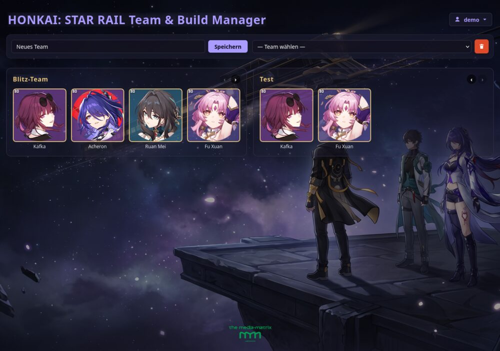

Die Bilder in dieser Anleitung zeigen Beispieldaten eines Demo-Kontos.

Eine Technik-Beschreibung für Entwickler steht in der [README](README.md).

**Inhalt:** [Loslegen](#loslegen) · [Teams und Builds](#teams-und-builds) · [Lichtkegel und Relikte](#lichtkegel-und-relikte) · [Tooltips](#tooltips) · [Android-App](#android-app) · [Passwort ändern](#passwort-ändern) · [Konto löschen](#konto-löschen) · [Daten mitnehmen](#daten-mitnehmen-oder-übertragen) · [Neue Charaktere eintragen](#neue-charaktere-und-lichtkegel-eintragen-administratoren) · [Desktop-Version](#desktop-version-optional) · [Über-Dialog und Version](#über-dialog-und-version) · [Wenn etwas nicht klappt](#wenn-etwas-nicht-klappt)

## Loslegen

1. **Konto anlegen:** Öffne <https://star-rail.media-matrix.de> und wähle „Jetzt registrieren“. Der Benutzername braucht mindestens 3 Zeichen, das Passwort mindestens 6.
2. **Anmelden** mit demselben Konto, im Browser oder in der App.
3. **Teams anlegen:** Ein Team besteht aus bis zu 4 Charakteren. Name vergeben, Charaktere aus der Liste wählen (mit Suche und Filtern), speichern.
4. **Builds pflegen:** Öffne in einem Team einen Charakter und lege seinen Build an oder bearbeite ihn.

<table>
  <tr>
    <td align="center">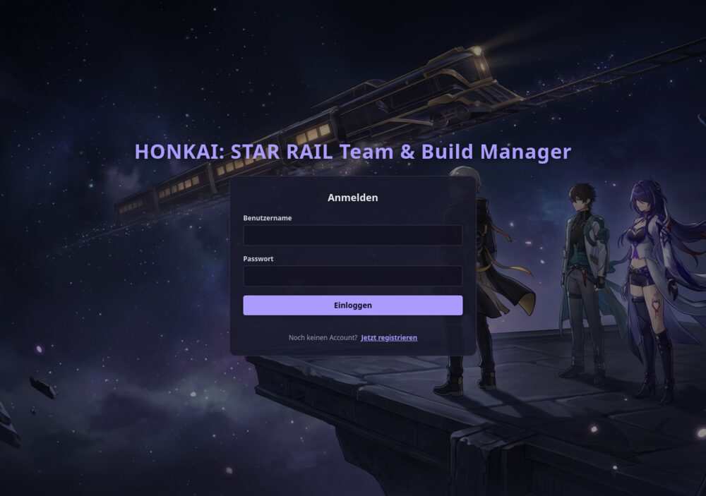 Anmeldung im Browser</td>
    <td align="center">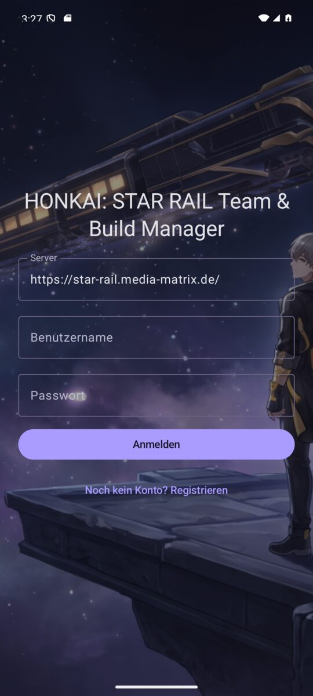 Anmeldung in der App</td>
  </tr>
</table>

In der App ist das Feld **„Server“** schon mit `https://star-rail.media-matrix.de/` ausgefüllt. Lass es so, es sei denn, du hast ausdrücklich eine andere Adresse bekommen. Ein Konto kannst du dort auch direkt über „Noch kein Konto? Registrieren“ anlegen.

## Teams und Builds

- **Ein Build gehört zum Charakter, nicht zum Team.** Steht Kafka in drei Teams, hat sie überall denselben Build. Änderst du ihn, ändert er sich in allen Teams.
- **Teams sortieren:** Mit den Pfeilen auf der Teamkarte verschiebst du Teams; im Browser geht das auch per Drag & Drop. Die Reihenfolge wird gespeichert. Auch die Charaktere in einem Team lassen sich mit Pfeilen oder (im Browser) per Ziehen am Kopf der Karte umsortieren.
- **Deine Daten sind nur deine:** Jedes Konto sieht nur die eigenen Teams und Builds.

**Im Browser** findest du Alle Teams, Neues Team, Exportieren, Importieren, Logout, Passwort ändern, Konto löschen und Über im Benutzermenü oben rechts (für Administratoren zusätzlich „Stammdaten aktualisieren“ nach „Importieren“):

  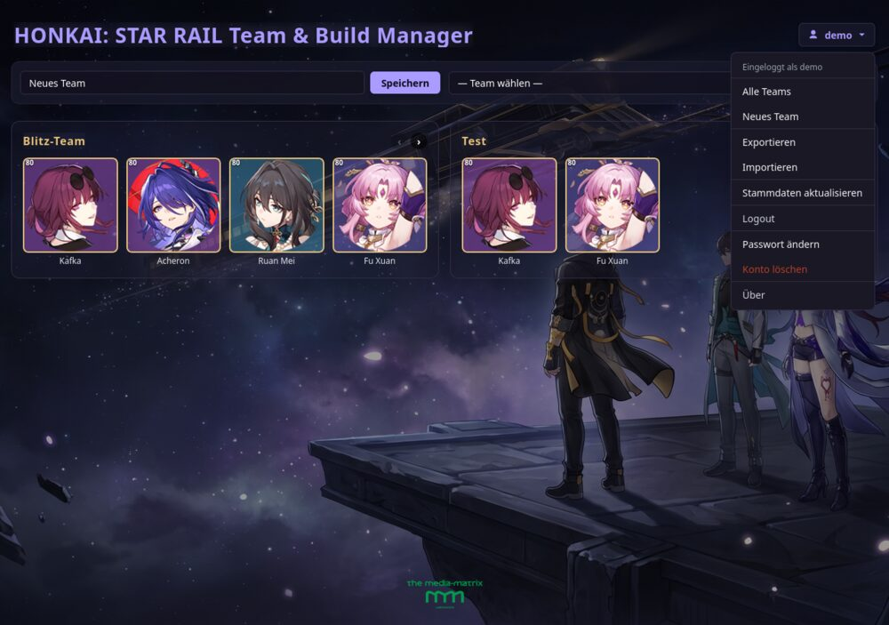

Ein Team öffnest du per Klick auf die Teamkarte. Jede Charakterkarte zeigt Level, Eidolon, Lichtkegel, die aktiven Set-Boni und die Talente; die Werte lassen sich direkt auf der Karte ändern:

  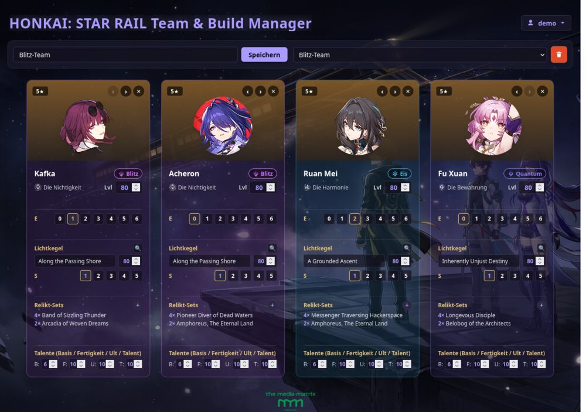

Mit dem **+** neben „Relikt-Sets“ öffnest du die Detailansicht und trägst die Werte der sechs Relikte ein:

  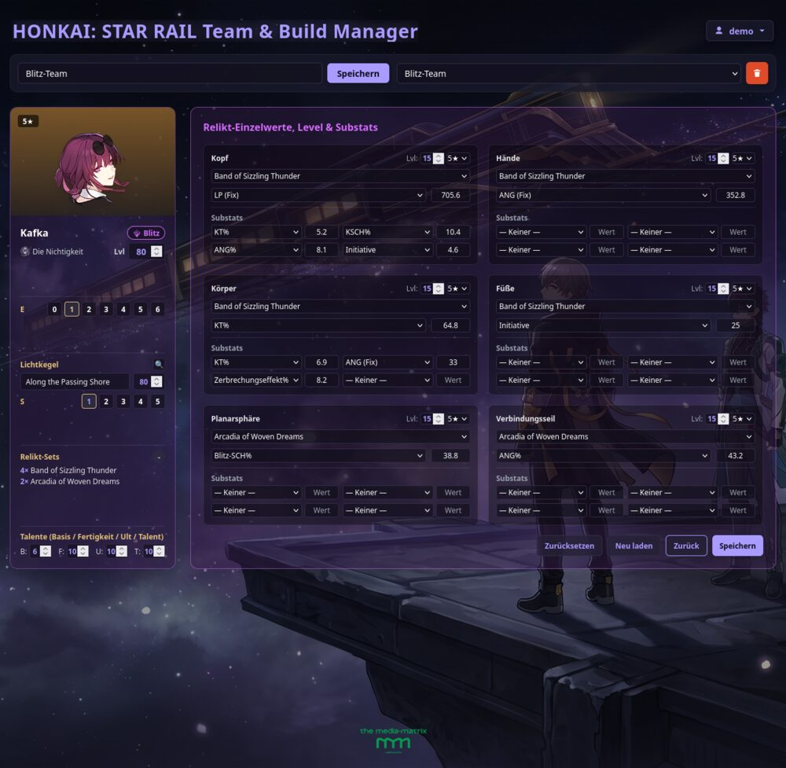

Charaktere wählst du über das Plus-Feld im Team. Die Suche filtert nach Name, Pfad, Element und Seltenheit:

  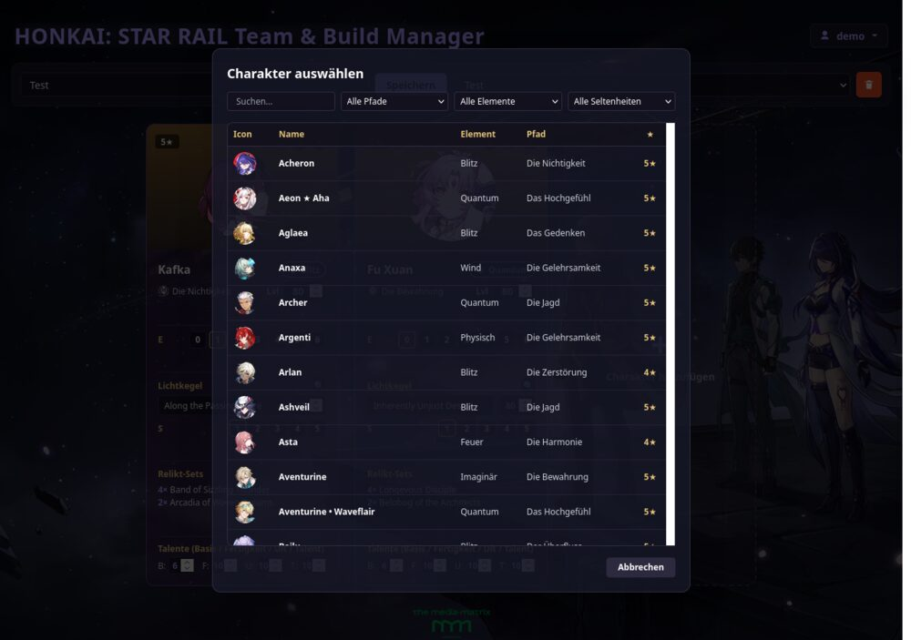

**In der App** tippst du auf einen Charakter, um seinen Build zu sehen, und oben rechts auf „Bearbeiten“, um ihn zu ändern. Beim Verlassen mit ungespeicherten Änderungen fragt die App nach, bevor sie etwas verwirft.

<table>
  <tr>
    <td align="center">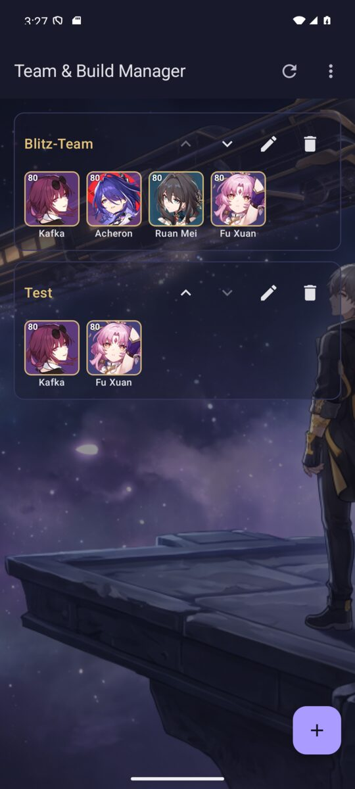 Teams</td>
    <td align="center">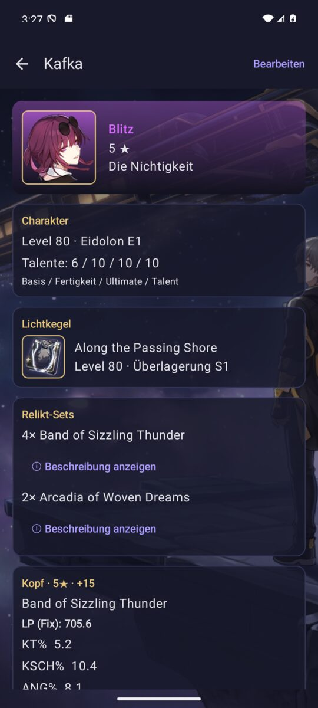 Build ansehen</td>
    <td align="center">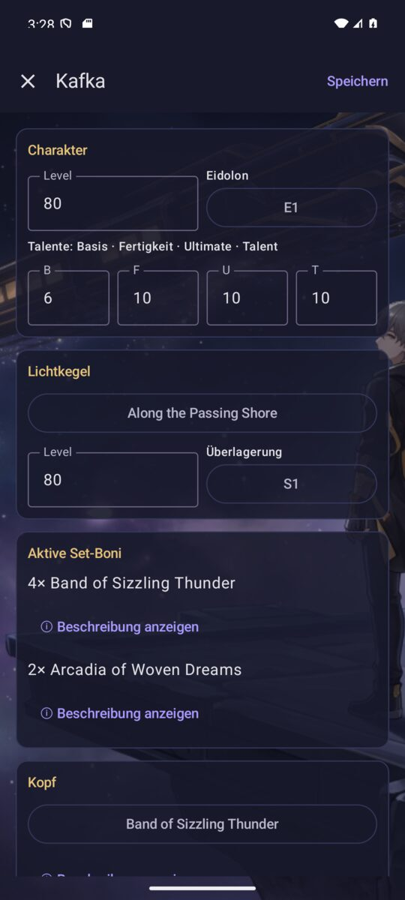 Build bearbeiten</td>
  </tr>
</table>

## Lichtkegel und Relikte

- **Lichtkegel:** Tippe bzw. klicke auf das Feld oder das 🔍, um einen zu wählen. Die Suche zeigt zuerst die Lichtkegel des **Pfads deines Charakters**; mit den Filtern siehst du auch alle anderen. Dazu kommen Level (1–80) und die **Überlagerung S1 bis S5**.
- **Relikte:** Jeder der sechs Slots hat ein eigenes Set, eine Seltenheit, ein Level (0–15), einen **Hauptwert** und bis zu **vier Substats** mit Wert.
  - **Kopf, Hände, Körper, Füße** nehmen **Relikt-Sets**, **Planarsphäre und Verbindungsseil** nehmen **Planar-Ornamente**. Die Auswahl zeigt automatisch nur die passenden Sets.
  - Der **Hauptwert** hängt vom Slot ab (Kopf immer LP, Hände immer ANG, Körper, Füße, Planarsphäre und Verbindungsseil mit eigenen Möglichkeiten).
- **Aktive Set-Boni:** Die Karte rechnet selbst aus, wie viele Teile desselben Sets du trägst: ab 2 Teilen der 2er-Bonus, ab 4 Teilen der 4er-Bonus. Planar-Ornamente zählen bis 2.
- **Talente:** Basisangriff bis Stufe 7, Fertigkeit, Ultimate und Talent bis Stufe 12 (die Eingabefelder begrenzen automatisch).

## Tooltips

Fahre im Browser oder am Desktop mit der Maus auf einen Lichtkegel oder ein Relikt-Set, um die **Beschreibung auf Deutsch** zu sehen:

- **Lichtkegel:** die Fähigkeit mit den Werten der **gewählten Überlagerung** (S1 bis S5). Wechselst du die Überlagerung, ändern sich die Werte im Tooltip mit. In der Suchliste siehst du die Fähigkeit bei S1.
- **Relikt-Sets:** der 2er- und der 4er-Bonus, in der Auswahl der Slots und auf der Karte bei den aktiven Boni.

**In der App** gibt es keinen Tooltip per Maus: Tippe stattdessen auf **„ⓘ Beschreibung anzeigen“** unter dem Lichtkegel bzw. dem Set. In den Auswahllisten stehen die ersten Zeilen der Beschreibung unter dem Namen.

## Android-App

**Voraussetzung:** Android 8.0 oder neuer. Die App gibt es nicht im Play Store; du bekommst die Datei `.apk` direkt vom Betreiber.

**Installieren**
1. APK aufs Handy oder Tablet bringen (Messenger, Cloud, USB).
2. Antippen. Android fragt, ob dein Browser bzw. Dateimanager Apps installieren darf; erlaube das für diesen einen Vorgang.
3. App öffnen und mit deinem Konto anmelden (oder dort direkt „Registrieren“ wählen).

**Aktualisieren:** Neue APK einfach über die alte installieren. Deine Anmeldung und Daten bleiben erhalten.

**Handy und Tablet**
- Das **Handy** bleibt im Hochformat, mit einer Spalte.
- Auf dem **Tablet** darf der Bildschirm gedreht werden. Teams und Builds stehen dort in mehreren Spalten, damit nichts verschenkt wird.

**Menü (⋮ oben rechts):** Abmelden, **Passwort ändern**, Über (Version) und Konto löschen; für Administratoren zusätzlich **Stammdaten aktualisieren**. „Neu laden“ (Pfeil daneben) holt den aktuellen Stand vom Server.

<table>
  <tr>
    <td align="center">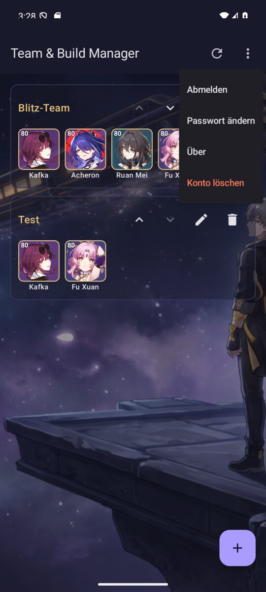 Menü der App</td>
    <td align="center">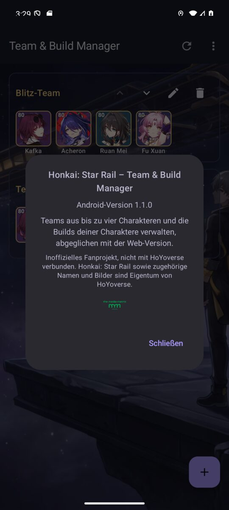 Über-Dialog</td>
  </tr>
</table>

**Ohne Internet:** Die zuletzt geladenen Teams und Builds lassen sich auch offline ansehen. Bearbeiten geht nur mit Verbindung; die App zeigt dann „Offline – Stand vom …“ an. Über „Neu laden“ wird es erneut versucht.

**Neue Charaktere ohne neue App:** Die App holt sich nach dem Laden neue Charaktere, Lichtkegel und Sets samt Bildern vom Server. Hat der Server neue Einträge, erscheinen sie in der Auswahl, ohne dass du die App aktualisieren musst.

## Passwort ändern

Du kannst dein Passwort selbst ändern, im Browser und in der App:

- **Im Browser:** Benutzermenü oben rechts → „Passwort ändern“.
- **In der App:** Menü ⋮ → „Passwort ändern“ (nur mit Verbindung).

Du gibst dein **aktuelles Passwort** und zweimal das **neue** ein (6 bis 72 Zeichen, es muss sich vom alten unterscheiden). Stimmt das aktuelle nicht, bleibt alles unverändert und du bekommst die Meldung „Das aktuelle Passwort ist falsch.“. Nach erfolgreicher Änderung musst du dich auf **anderen Geräten** neu anmelden; das Gerät, an dem du es geändert hast, bleibt angemeldet.

<table>
  <tr>
    <td align="center">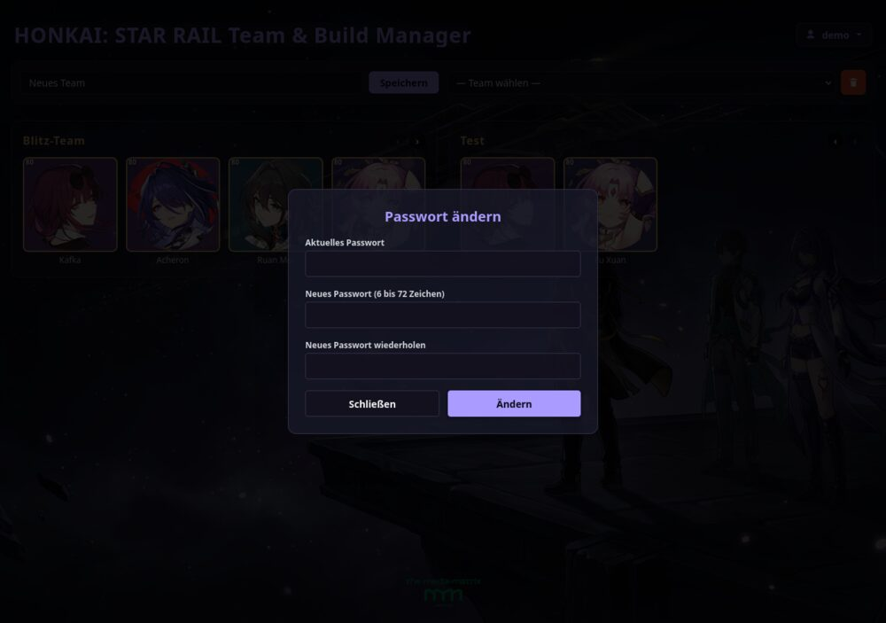 Im Browser</td>
    <td align="center">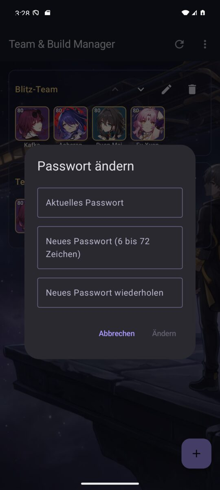 In der App</td>
    <td align="center">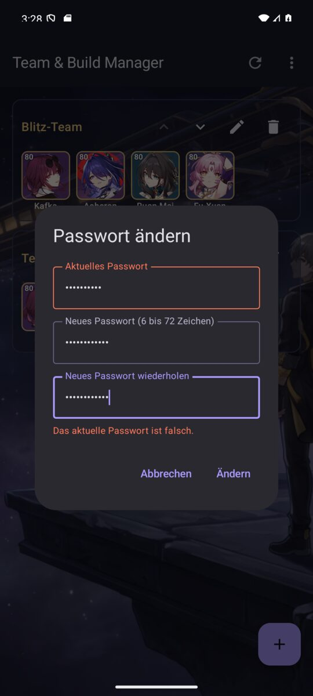 Falsches aktuelles Passwort</td>
  </tr>
</table>

Wähle ein Passwort, das du nirgendwo sonst benutzt. Ein Passwort **zurücksetzen** (wenn du es vergessen hast) geht nicht von selbst; wende dich in dem Fall an den Betreiber.

## Konto löschen

Wenn du die App nicht mehr nutzen möchtest, kannst du dein Konto selbst löschen. **Dabei werden dein Konto, alle Teams und alle Builds endgültig entfernt, in Browser und App. Das lässt sich nicht rückgängig machen.**

- **Im Browser:** Benutzermenü oben rechts → „Konto löschen“.
- **In der App:** Menü ⋮ → „Konto löschen“ (nur mit Verbindung).

Du bestätigst mit deinem Passwort. Stimmt es nicht, bleibt alles unverändert und du bekommst die Meldung „Passwort falsch.“. Exportiere vorher, wenn du deine Daten behalten willst (siehe unten).

  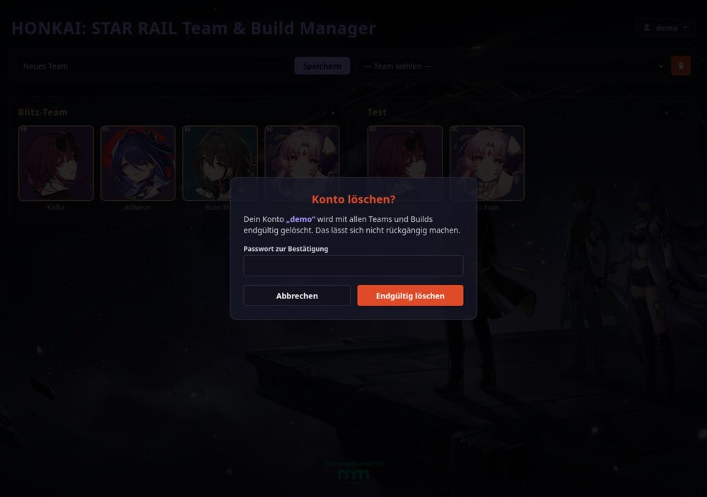

## Daten mitnehmen oder übertragen

Teams und Builds lassen sich als JSON-Datei exportieren und wieder importieren, zum Beispiel zum Sichern oder um Daten aus der Desktop-Version in die Web-Version zu übernehmen. Im Browser findest du beides im Benutzermenü („Exportieren“, „Importieren“), am Desktop im Menü „Datei“. Beim Import fragt das Programm, ob es mit deinen vorhandenen Daten **zusammenführen** soll (gleichnamige Builds und Teams werden überschrieben, alles andere bleibt) oder ob es **alles ersetzen** soll. Charaktere, die es nicht gibt, werden übersprungen und gemeldet.

## Neue Charaktere und Lichtkegel eintragen (Administratoren)

Kommt im Spiel etwas Neues dazu, tragen Administratoren es selbst ein. Du erkennst dich als Administrator daran, dass dein Benutzermenü (Browser) bzw. Menü ⋮ (App) den Punkt **„Stammdaten aktualisieren“** enthält:

1. Der Dialog gleicht die öffentliche Datenquelle mit der Datenbank ab und listet, was fehlt (Charaktere, Lichtkegel, Relikt-Sets).
2. Prüfe die Liste: Die Quelle kann Einträge enthalten, die im Spiel **noch nicht erschienen** sind. Setze nur bei dem einen Haken, was wirklich verfügbar ist.
3. „Ausgewählte eintragen“ legt die Einträge samt Bildern an. Danach stehen sie sofort in der Auswahl (in der App nach dem Neu-Laden).

  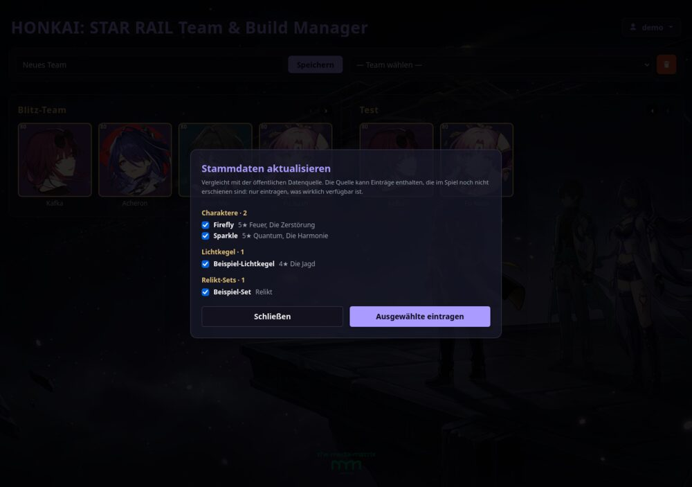

Wer kein Administrator ist, sieht den Punkt nicht; fehlt dir ein Charakter oder Lichtkegel, melde das dem Betreiber.

## Desktop-Version (optional)

Es gibt auch eine Desktop-App, die ihre Daten lokal in einer Datei speichert und **kein Konto** braucht. Sie läuft direkt aus dem Quellcode (Python und PySide6, siehe [desktop/README.md](desktop/README.md)); Builds und Teams lassen sich per JSON-Export mit der Web-Version austauschen.

<table>
  <tr>
    <td align="center">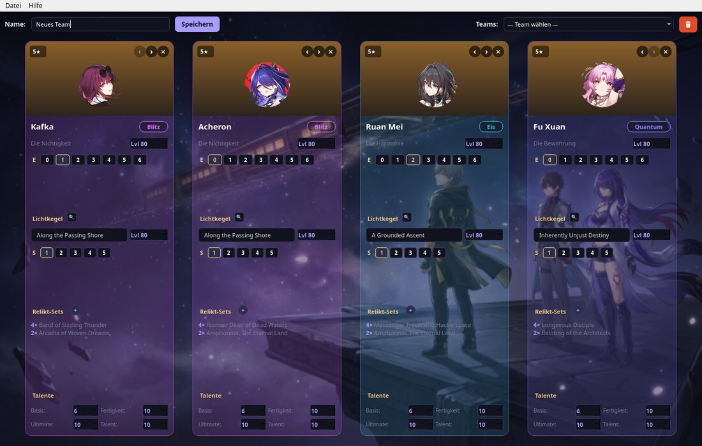 Ein Team</td>
    <td align="center">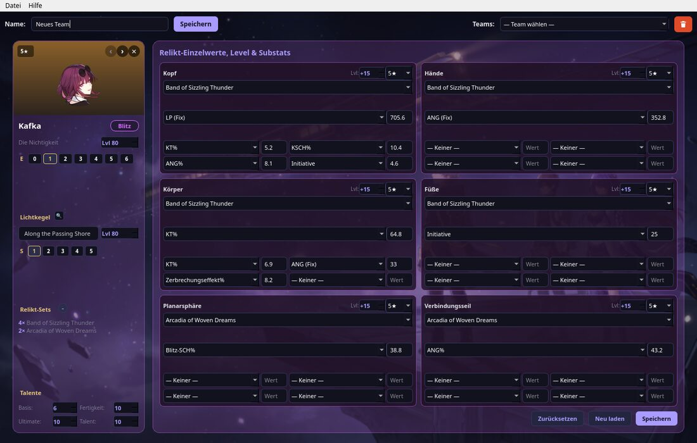 Relikt-Details</td>
  </tr>
  <tr>
    <td align="center">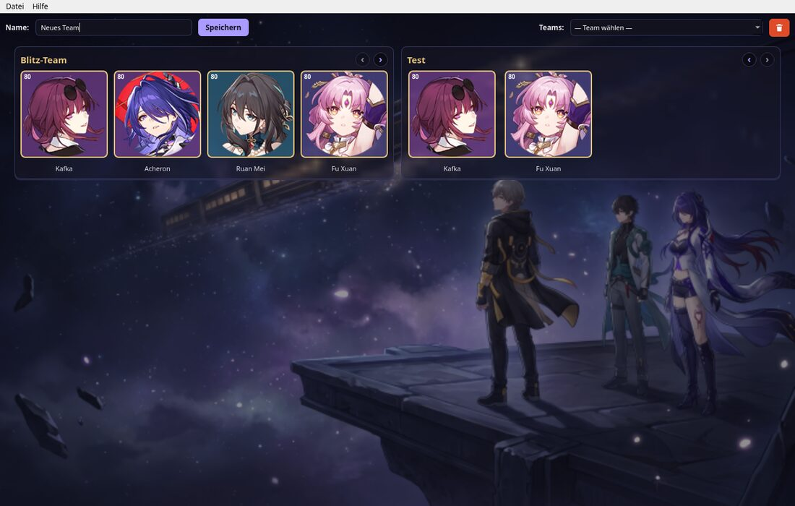 Alle Teams (Datei → Alle Teams)</td>
    <td align="center">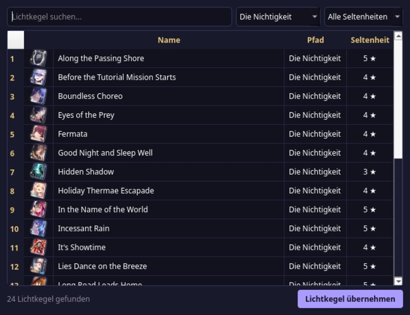 Lichtkegel wählen, mit Tooltip der Fähigkeit</td>
  </tr>
</table>

## Über-Dialog und Version

Im Browser (Benutzermenü → „Über“), in der App (Menü ⋮ → „Über“) und am Desktop (Hilfe → „Über…“) zeigt ein kleiner Dialog die **Version**, einen Hinweis zum Fanprojekt und das Logo von the media-matrix. Ein Klick bzw. Tipp auf das Logo öffnet www.media-matrix.de. Nenne die Version, wenn du einen Fehler meldest.

<table>
  <tr>
    <td align="center">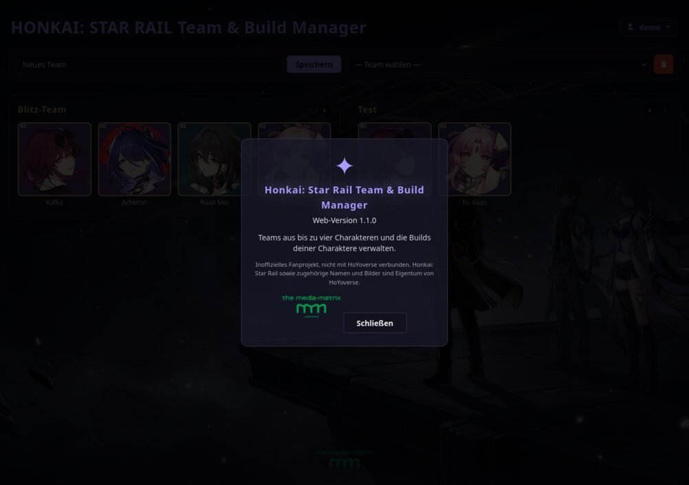 Browser</td>
    <td align="center">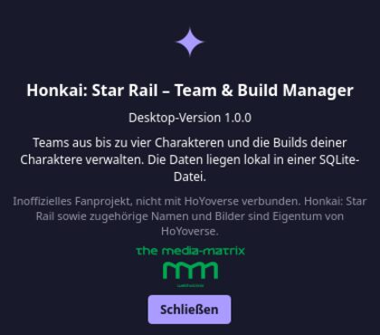 Desktop</td>
  </tr>
</table>

## Wenn etwas nicht klappt

| Problem | Lösung |
|---|---|
| „Dieser Benutzername ist bereits vergeben“ | Anderen Namen wählen. |
| „Benutzername oder Passwort falsch.“ | Auf Groß- und Kleinschreibung achten. Passwort-Manager füllen manchmal ein **altes** Passwort ein: im privaten Fenster und von Hand eintippen. |
| „Zu viele Anmeldeversuche“ | Etwa 15 Minuten warten; der Server bremst wiederholte Fehlversuche. |
| „Passwort falsch.“ beim Konto löschen | Passwort prüfen; es wird erst bei richtiger Eingabe gelöscht. |
| „Das aktuelle Passwort ist falsch.“ beim Ändern | Aktuelles Passwort prüfen; das neue muss 6 bis 72 Zeichen lang sein und sich vom alten unterscheiden. |
| App zeigt „Offline“ | Internetverbindung prüfen, dann „Neu laden“. |
| Anmeldung in der App schlägt fehl | Prüfe, ob im Feld „Server“ `https://star-rail.media-matrix.de/` steht. |
| Installation der APK wird abgelehnt | Installation aus dieser Quelle in den Android-Einstellungen erlauben. |
| Kein Tooltip an einem Lichtkegel | In der App stattdessen „ⓘ Beschreibung anzeigen“ antippen. Fehlt der Text überall, die Seite neu laden. |
| Ein Charakter, Lichtkegel oder Set fehlt | Ein Administrator trägt ihn über „Stammdaten aktualisieren“ ein; sonst beim Betreiber melden. |
| „Menüpunkt Stammdaten aktualisieren fehlt“ | Der Punkt ist nur für Administratoren. In der App erscheint er nach dem ersten Laden der Teams. |

## Hinweis

Inoffizielles Fanprojekt, nicht mit HoYoverse verbunden. Honkai: Star Rail sowie zugehörige Namen und Bilder sind Eigentum von HoYoverse.
