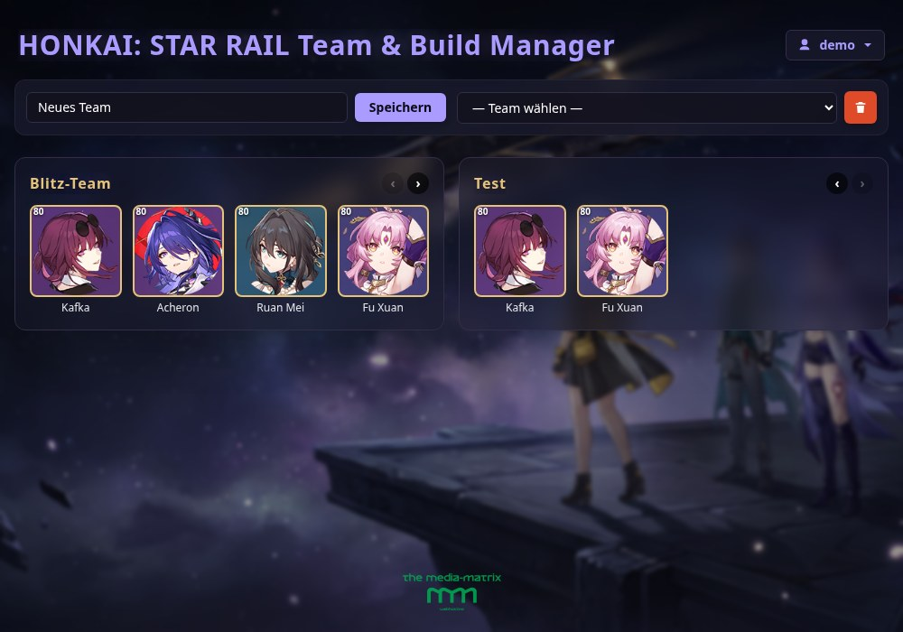
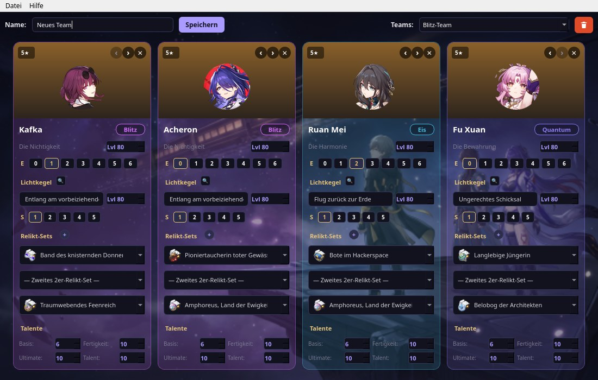
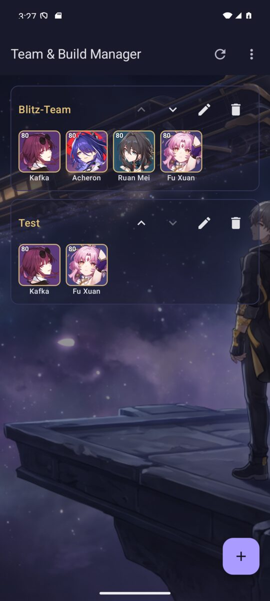
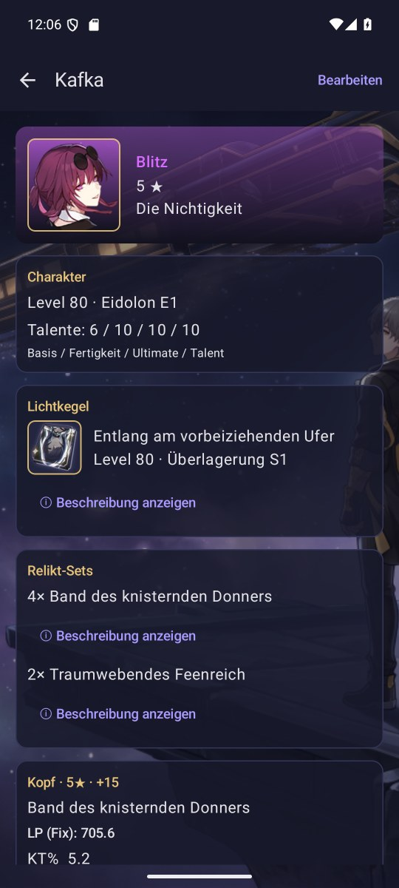

# Honkai: Star Rail – Team & Build Manager

Teams aus bis zu vier Charakteren zusammenstellen und für jeden Charakter einen Build verwalten: Level, Eidolon, Talente, Lichtkegel (Level und Überlagerung) und alle sechs Relikte mit Set, Hauptwert und Substats. Es gibt drei Clients für dieselben Daten: eine **Web-App**, eine **Android-App** und eine **Desktop-App**.

<p align="center">
  
</p>

| Desktop | Android: Teams | Android: Build |
|:---:|:---:|:---:|
|  |  |  |

<sub>Alle Screenshots zeigen Beispieldaten eines Demo-Kontos.</sub>

Du spielst nur mit und willst die App benutzen? Dann geht es hier zur [Anleitung für Mitspieler](ANLEITUNG.md).

**Inhalt:** [Funktionen](#funktionen) · [Die drei Clients](#die-drei-clients) · [Schnellstart](#schnellstart) · [Wie die Teile zusammenhängen](#wie-die-teile-zusammenhängen) · [Aufbau des Repositorys](#aufbau-des-repositorys) · [Gemeinsame Daten](#gemeinsame-daten) · [Stammdaten aktualisieren](#stammdaten-aktualisieren) · [Konten und Administratoren](#konten-und-administratoren) · [Entwicklung und Tests](#entwicklung-und-tests) · [Bereitstellung](#bereitstellung) · [Versionen](#versionen) · [Persönliche Daten](#persönliche-daten)

## Funktionen

- **Teams** mit bis zu 4 Charakteren anlegen, speichern, umbenennen und löschen; die Reihenfolge der Teams und der Charaktere im Team lässt sich verschieben (Pfeile in allen Clients, in Web und Desktop auch per Drag & Drop) und wird gespeichert
- **Builds pro Charakter:** Level 1–80, Eidolon E0–E6, Talente (Basisangriff bis 7, Fertigkeit, Ultimate und Talent bis 12), Lichtkegel mit Level und Überlagerung S1–S5
- **Relikt-Details:** sechs Slots (Kopf, Hände, Körper, Füße, Planarsphäre, Verbindungsseil). Kopf bis Füße nehmen Relikt-Sets, Planarsphäre und Verbindungsseil Planar-Ornamente. Die Set-Auswahl zeigt zu jedem Set sein Icon (Web mit Suchfeld, Desktop und Android ebenfalls mit Icons). Je Slot Seltenheit, Level 0–15, Hauptwert (passend zum Slot) und bis zu 4 Substats
- **Aktive Set-Boni** berechnet jede Karte selbst aus den sechs Slots (2er und 4er; Ornamente zählen bis 2)
- **Tooltips** mit den Beschreibungen: die Fähigkeit des Lichtkegels passend zur gewählten Überlagerung und die Boni der Relikt-Sets, jeweils auf Deutsch
- **Suche und Filter** für Charaktere (Pfad, Element, Seltenheit) und Lichtkegel (Pfad, Seltenheit)
- **Austausch** von Builds und Teams zwischen allen Clients als JSON-Datei (`star-rail-team-manager`, Version 1)
- **Konto** (Web, Android): Registrieren, Anmelden, **Passwort ändern** und endgültiges Löschen samt Teams und Builds (nach erneuter Passworteingabe)
- **Stammdaten aktualisieren** für Administratoren: neue Charaktere, Lichtkegel und Relikt-Sets samt Bildern direkt aus dem Menü eintragen (Web und Android)
- **Handy und Tablet** (Android): Das Handy bleibt im Hochformat (eine Spalte); auf dem Tablet drehbar, mit mehreren Spalten
- **Offline ansehen** (Android): Teams und Builds bleiben auch ohne Verbindung sichtbar
- **„Über“-Dialog** in allen Clients mit Version, Hinweis zum Fanprojekt und dem Logo von the media-matrix

Ein Build gehört zum **Charakter, nicht zum Team**: Kommt ein Charakter in mehreren Teams vor, hat er überall denselben Build.

## Die drei Clients

| | Web | Android | Desktop |
|---|---|---|---|
| **Technik** | HTML/JavaScript (Tailwind), PHP | Kotlin, Jetpack Compose | Python, PySide6 (Qt) |
| **Daten** | MySQL/MariaDB auf dem Server | über die Web-API (Online-Client) | lokale SQLite-Datei |
| **Konten** | Registrierung, Login, Passwort ändern, Konto löschen, Daten je Nutzer | Anmeldung am Web-Konto per Token, dazu Passwort ändern, Registrierung, Konto löschen | ein Nutzer, lokal, ohne Konto |
| **Voraussetzung** | Webserver mit PHP 8 und MySQL/MariaDB | Android 8.0 oder neuer (Handy und Tablet) | Python 3.10+, PySide6 |
| **Doku** | [web/README.md](web/README.md) | [android/README.md](android/README.md) | [desktop/README.md](desktop/README.md) |

Die Live-Version läuft unter <https://star-rail.media-matrix.de>.

## Schnellstart

**Web** (lokal, mit dem eingebauten PHP-Server; die Datenbank wird per `web/api/config.local.php` konfiguriert, siehe [web/README.md](web/README.md))

```sh
cd web
php -S localhost:8000
```

**Android** (eine fertige APK wird nicht verteilt, die App baut man selbst; Details in [android/README.md](android/README.md))

```sh
cd android
./gradlew :app:assembleDebug        # Debug-APK unter app/build/outputs/apk/debug/
```

Die App braucht eine erreichbare Web-Version als Server; auf der Anmeldeseite ist das Feld „Server“ mit `https://star-rail.media-matrix.de/` vorbelegt.

**Desktop**

```sh
cd desktop
python -m venv .venv && source .venv/bin/activate
pip install -r requirements.txt
python main.py
```

Beim ersten Start legt die App die Datenbank an und spielt die Stammdaten aus `shared/stammdaten.json` ein.

## Wie die Teile zusammenhängen

```
 Desktop (SQLite) ──┐
                    │   JSON-Datei (Datei → Exportieren / Importieren)
                    ├────────────────────────────────────────────┐
                    │                                            ▼
 Android ── HTTPS + Token ───────────────────►  Web-API (PHP) ── MySQL
                                                      ▲
 Browser ──── HTTPS + Session ───────────────────────┘
```

- **Web** ist der gemeinsame Server. Browser melden sich per Session an, Apps per Token (`Authorization: Bearer …`, ersatzweise `X-Auth-Token`).
- **Android** greift nie direkt auf die Datenbank zu, sondern nur über die API. Der Datenbankzugang bleibt auf dem Server.
- **Desktop** arbeitet eigenständig mit seiner lokalen Datenbank. Builds und Teams lassen sich als JSON exportieren und in der Web-Version importieren, und umgekehrt.

## Aufbau des Repositorys

```
web/          Web-App
  index.html     komplettes Frontend (eine Datei, Tailwind per CDN, Vanilla JS)
  api/           PHP-Endpunkte (JSON-API)
  migrations/    SQL-Änderungen für bestehende Datenbanken
  schema.sql     Datenbankschema
  seed_stammdaten.sql   Stammdaten als SQL (erzeugt, siehe unten)
  tools/         make_seed.py (erzeugt den Seed aus shared/stammdaten.json)
android/      Android-App (Gradle-Projekt)
desktop/      Desktop-App (Qt-Widgets, SQLite-Zugriff, Tests)
shared/       Gemeinsame Daten aller Clients
  stammdaten.json          Charaktere, Lichtkegel, Relikt-Sets (mit Texten)
  assets/images/           Bilder, nach Typ in Unterordnern (characters, light_cones, relic_sets, elements, paths, ui)
  exchange-format.md       Spezifikation des JSON-Austauschs
tools/        update_stammdaten.py (Stammdaten aktualisieren), remote_sql.py (SQL auf dem Server)
deploy/       Upload-Skript für die Web-Version
docs/         Screenshots
```

`web/assets` ist ein Symlink auf `shared/assets`, damit das Frontend seine Bilder unter `/assets/…` findet. Beim Hochladen wird er aufgelöst (das übernimmt das Deploy-Skript).

## Gemeinsame Daten

- **Stammdaten** (`shared/stammdaten.json`): eine Quelle für alle Clients. Der Desktop spielt sie beim Start in SQLite ein, die Android-App liest sie direkt aus den Assets (und gleicht sie mit dem Server ab), die Web-Version hat sie in der Datenbank. Die Namen von Charakteren, Lichtkegeln und Sets sind englisch wie in der Datenquelle; **Pfade, Elemente, Fähigkeiten und Set-Boni sind deutsch**.
- **Pfade** heißen wie im Spiel: Die Zerstörung, Die Jagd, Die Gelehrsamkeit, Die Harmonie, Die Nichtigkeit, Die Bewahrung, Der Überfluss, Das Gedenken, Das Hochgefühl. **Elemente:** Physisch, Feuer, Eis, Blitz, Wind, Quantum, Imaginär.
- **Trailblazer** gibt es je Pfad einmal, ohne Artikel im Namen: `Trailblazer (Gedenken)`. Teams und Builds hängen am Charakternamen, deshalb ändern sich Namen nicht.
- **Bilder** liegen unter `shared/assets/images/` und liegen nach Typ getrennt in Unterordnern: `characters/<name>.png`, `light_cones/<name>.png`, `relic_sets/<name>.png`, `paths/<pfad>.png` und `elements/<element>.png` (Kleinbuchstaben, alles außer a–z und 0–9 wird zu `_`). In `ui/` liegen Hintergrund (`star-rail-bg.jpg`) und Logo.
- **Austauschformat** (`shared/exchange-format.md`): `{"format": "star-rail-team-manager", "version": 1, "builds": [...], "teams": [...]}`. Änderungen am Format müssen in allen Clients nachgezogen werden.

## Stammdaten aktualisieren

Ein Befehl erledigt alles:

```sh
python3 tools/update_stammdaten.py --auto
```

Er vergleicht Charaktere, Lichtkegel und Relikt-Sets mit der Quelle [Mar-7th/StarRailRes](https://github.com/Mar-7th/StarRailRes), ergänzt Fehlendes in `shared/stammdaten.json` (samt deutschen Fähigkeiten und Set-Boni), lädt die Bilder, committet lokal (ohne Push), deployt per `deploy/deploy.sh`, spielt die Daten über `tools/remote_sql.py` in die Server-Datenbank ein und prüft zum Schluss über die API, ob alles online ist. Ein zweiter Aufruf meldet „Alles aktuell“, der Befehl eignet sich also für regelmäßige Läufe.

```sh
python3 tools/update_stammdaten.py            # nur prüfen (Exit-Code 1 = es fehlt etwas), ändert nichts
python3 tools/update_stammdaten.py --apply    # nur lokal ergänzen (mit Rückfrage), ohne Deploy und Datenbank
python3 tools/update_stammdaten.py --texts    # Fähigkeiten und Set-Boni aller Einträge neu einlesen (mit --auto auch deployen)
python3 tools/remote_sql.py web/migrations/<datei>.sql           # eine SQL-Datei (INSERT/UPDATE/DELETE) auf dem Server ausführen
python3 tools/remote_sql.py --ddl web/migrations/<datei>.sql     # zusätzlich ALTER TABLE … MODIFY / ADD COLUMN
```

**Sicherungen:** `--auto` bricht ohne Änderung ab, wenn mehr als 15 neue Einträge gefunden werden (`--max-new`), denn die Quelle enthält manchmal Einträge, die im Spiel noch nicht erschienen sind. Ein **neuer Pfad oder ein neues Element** wird nur gemeldet, nicht eingetragen: Die Spalten sind ENUMs, erst Schema, Migration, Icon und Filter ergänzen (Hinweise im Kopf des Skripts). Gleiche Namen in der Quelle (z. B. zwei „March 7th“) löst das Skript auf: Die kleinste ID behält den Namen, die übrigen bekommen den Pfad als Zusatz.

**Im Web und in Android** geht dasselbe für Administratoren über den Menüpunkt „Stammdaten aktualisieren“: Der Dialog listet, was fehlt; ausgewählt wird per Haken. Das ändert nur die Datenbank und die Bilder auf dem Server, nicht `shared/stammdaten.json` im Repository (ein späterer Lauf des Skripts holt das lokal nach, ohne etwas doppelt anzulegen).

**Wie die Datenbank ohne phpMyAdmin erreicht wird:** Sie ist nur vom Server aus erreichbar. `tools/remote_sql.py` lädt eine einmalige PHP-Datei (`api/_sql_<zufall>.php`) per FTPS hoch und ruft sie per HTTPS auf. Die Datei enthält nur den SHA-256-Hash eines Zufalls-Tokens, nutzt die `api/db.php` des Servers, führt alles in einer Transaktion aus (nur INSERT/UPDATE/DELETE/REPLACE; mit `--ddl` zusätzlich Spalten ändern oder ergänzen, dann ohne Transaktion), löscht sich selbst und wird vom Skript per FTP-Liste kontrolliert.

## Konten und Administratoren

- Konten sind für jeden offen (Registrierung), aber auf dem Server begrenzt; Passwörter liegen nur als bcrypt-Hash in der Datenbank. Die Begrenzung von Anmeldeversuchen steht in [web/README.md](web/README.md).
- **Administratoren** stehen in `web/api/admins.local.php` (`<?php return ['benutzername'];`, auch per Umgebungsvariable `ADMIN_USERS`, kommagetrennt). Die Datei liegt nicht im Git und wird vom Deploy nie hochgeladen; sie muss einmal auf dem Server angelegt werden. Ohne Eintrag gibt es keinen Administrator, und die Funktion „Stammdaten aktualisieren“ ist für niemanden sichtbar.
- Der Server prüft die Administrator-Rolle bei jeder Anfrage selbst, nicht nur das Menü.

## Entwicklung und Tests

- **Web:** Es gibt keinen Build-Schritt. PHP-Dateien prüft man mit `php -l web/api/<datei>.php`; zum Testen der API gegen eine echte MariaDB siehe [web/README.md](web/README.md).
- **Android:** `cd android && ./gradlew :app:testDebugUnitTest` prüft Stammdaten (Bilder, Texte), Austauschformat, Bearbeitungslogik, Passwort-Regeln und die Antworten der Aktualisierung (11 Tests).
- **Desktop:** `cd desktop && python -m unittest discover -s tests -v` (44 Tests; die Oberfläche läuft ohne Bildschirm mit `QT_QPA_PLATFORM=offscreen`).
- **Konventionen:** Oberfläche, Fehlermeldungen und Kommentare sind deutsch. Werte, die per `innerHTML` ins Web-Frontend gelangen, gehen durch `escapeHtml()`. Grenzen (Level 1–80, Eidolon 0–6, Talente 1–7 bzw. 1–12, Relikt-Level 0–15) stehen im Server (`web/api/helpers.php`), Desktop (`desktop/models.py`), Android (`BuildEditing.kt`) und in den Eingabefeldern des Frontends und müssen zusammenpassen.

## Bereitstellung

- **Web-Version hochladen:** `deploy/deploy.sh --dry-run` zeigt, was sich ändern würde, `deploy/deploy.sh` lädt es per FTPS hoch (Zugangsdaten in `deploy/deploy.local.env`, Vorlage: `deploy/deploy.example.env`; Anleitung in [deploy/README.md](deploy/README.md)). Das Skript lädt nur Geändertes hoch, sichert vorher die überschriebenen Dateien und fasst `api/config.local.php` und `api/admins.local.php` nie an.
- **Datenbank:** Das Schema steht in `web/schema.sql`, Änderungen für bestehende Datenbanken in `web/migrations/` (jede Migration einmal ausführen, am bequemsten mit `tools/remote_sql.py`). Die Stammdaten kommen aus `web/seed_stammdaten.sql`; die Datei ist wiederholbar (vorhandene Einträge werden aktualisiert).
- **Android-Release:** Signieren und Bauen beschreibt [android/README.md](android/README.md). Eine fertige APK wird nicht veröffentlicht.

## Versionen

Web, Desktop und Android tragen dieselbe Versionsnummer (zwischenzeitlich liefen sie getrennt); aktuell überall **1.2.1**. Sie stehen jeweils im „Über“-Dialog (Web: Benutzermenü → Über; Android: Menü ⋮ → Über; Desktop: Hilfe → Über…) und an diesen Stellen im Code, die bei jeder Version zusammen mit dem [CHANGELOG.md](CHANGELOG.md) hochgezählt werden:

| Client | Stelle |
|---|---|
| Web | `web/index.html` (Element `#webVersion`) |
| Android | `android/app/build.gradle.kts` (`versionName`, `versionCode`) |
| Desktop | `desktop/models.py` (`APP_VERSION`) |

Ein Desktop-Test prüft, dass die Version mit dem obersten Desktop-Eintrag des Changelogs übereinstimmt. Den Änderungsverlauf siehe [CHANGELOG.md](CHANGELOG.md).

## Persönliche Daten

Diese Dateien enthalten persönliche Daten oder Zugangsdaten und stehen in der `.gitignore`: `desktop/star_rail_manager.db` (Teams und Builds), `web/api/config.local.php` (Datenbank), `web/api/admins.local.php` (Administratoren), `deploy/deploy.local.env` (FTP), `android/keystore.properties` und `android/*.keystore` (Signierschlüssel; unbedingt separat sichern).

## Hinweis

Inoffizielles Fanprojekt, nicht mit HoYoverse verbunden. Honkai: Star Rail sowie zugehörige Namen und Bilder sind Eigentum von HoYoverse. Die Daten stammen aus [Mar-7th/StarRailRes](https://github.com/Mar-7th/StarRailRes).
